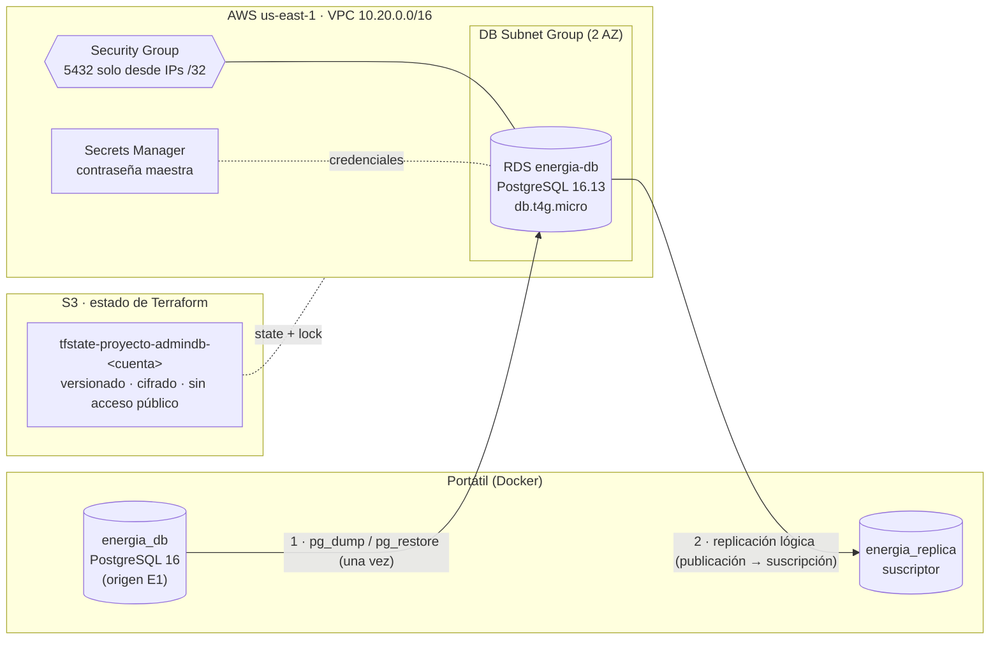

# Entrega 2 · Informe técnico de despliegue en AWS RDS y sincronización nube-local

**Proyecto:** Sistema Energético Colombiano (`energia_db`) · **Asignatura:** Administración de Bases de Datos (ED1302)
**Equipo:** Mauricio Correa Celis · Daniel Restrepo · Cristian Troncoso · **Fecha:** 2026-11-25

> **Estado de las evidencias.** Las secciones 3 a 5 (estado remoto, infraestructura y migración) están ejecutadas y documentadas con sus logs. Las secciones 6 a 8 (paridad, replicación y PITR) describen el procedimiento y el criterio de éxito. Sus resultados se completan con los logs de `make paridad`, `make replica`, `make demo-replica` y `make pitr` (marcados como **⏳ Pendiente**).

---

## 1. Resumen

La base de la Entrega 1 (PostgreSQL 16 en Docker) se desplegó en **Amazon RDS for PostgreSQL 16.13**, dentro de una VPC propia en `us-east-1`. Toda la infraestructura se declara con **Terraform**. El estado de Terraform se guarda en un **bucket S3 creado antes que cualquier otro recurso**, para que los tres integrantes trabajen sobre el mismo estado sin pisarse.

La migración inicial se hizo con `pg_dump`/`pg_restore` y tardó unos 9,5 minutos. La sincronización continua usa **replicación lógica nativa**: RDS publica los cambios y una base local (`energia_replica`) se suscribe. La recuperación ante errores se demuestra con una **restauración a un punto en el tiempo (PITR)** que deshace un `DELETE` accidental.

| Requisito de la guía | Cómo se cumple | Evidencia |
|---|---|---|
| Aprovisionamiento RDS (VPC, SG, Subnet Group, red segura) | Terraform: `infra/terraform/red.tf`, `rds.tf` | Plan y apply en `evidencias/E2/tf-*.log` + capturas |
| Migración `pg_dump` / `pg_restore` | `make migrar` → `infra/aws/migrar.sh` | `evidencias/E2/migrar_20261125_222148.log` |
| Sincronización / replicación lógica local ↔ RDS | `make replica` y `make demo-replica` | ⏳ Pendiente |
| Automated backups + prueba de PITR | Retención automática + `make pitr` | ⏳ Pendiente |

---

## 2. Arquitectura



| Recurso | Nombre / valor | Para qué |
|---|---|---|
| Bucket S3 | `tfstate-proyecto-admindb-786888028496` | Estado remoto compartido de Terraform |
| VPC | `energia-db-vpc` · `10.20.0.0/16` · DNS habilitado | Red aislada del proyecto |
| Subredes | `10.20.0.0/24` y `10.20.1.0/24` en dos AZ distintas | El DB Subnet Group de RDS exige al menos 2 AZ |
| Internet Gateway + Route Table | `0.0.0.0/0 → IGW` | Acceso desde los portátiles del equipo |
| DB Subnet Group | `energia-db-subnets` | Dónde puede vivir la instancia |
| Security Group | `energia-db-db` · TCP 5432 solo desde `allowed_cidrs` (/32) | Control de acceso por IP |
| Parameter Group | `energia-db-pg16` (familia `postgres16`) | Replicación lógica, SSL obligatorio, log de consultas lentas |
| Instancia RDS | `energia-db` · PostgreSQL 16.13 · `db.t4g.micro` · Single-AZ · 20 GB gp3 cifrado | Base de datos en la nube |
| Secreto | Generado por RDS (`manage_master_user_password`) | Contraseña maestra fuera del repo y del state |

---

## 3. Paso 0 · Bucket S3 para el estado de Terraform

**Por qué primero.** Terraform guarda en un archivo de estado (`terraform.tfstate`) qué recursos creó y con qué IDs. Si ese archivo vive en el portátil de una persona, los otros dos integrantes no pueden aplicar cambios sin duplicar o romper recursos. Por eso, antes de declarar cualquier infraestructura, se creó un bucket S3 que guarda el estado de forma central. El bucket se crea con la CLI y no con Terraform, porque Terraform necesita que el bucket exista **antes** de poder guardar su propio estado allí (el problema del huevo y la gallina).

```bash
ACCOUNT=$(aws sts get-caller-identity --query Account --output text)
BUCKET="tfstate-proyecto-admindb-${ACCOUNT}"   # el ID de cuenta hace el nombre único en S3
REGION="us-east-1"

aws s3api create-bucket --bucket "$BUCKET" --region "$REGION"

# Versionado: permite recuperar una versión anterior si el estado se corrompe
aws s3api put-bucket-versioning --bucket "$BUCKET" \
  --versioning-configuration Status=Enabled

# Cifrado en reposo por defecto (SSE-S3)
aws s3api put-bucket-encryption --bucket "$BUCKET" \
  --server-side-encryption-configuration \
  '{"Rules":[{"ApplyServerSideEncryptionByDefault":{"SSEAlgorithm":"AES256"},"BucketKeyEnabled":true}]}'

# Bloqueo total de acceso público: el state contiene endpoints e IDs de la infraestructura
aws s3api put-public-access-block --bucket "$BUCKET" \
  --public-access-block-configuration \
  "BlockPublicAcls=true,IgnorePublicAcls=true,BlockPublicPolicy=true,RestrictPublicBuckets=true"
```

**Configuración del backend** (`infra/terraform/versions.tf`):

```hcl
backend "s3" {
  key          = "energia-db/e2/terraform.tfstate"
  region       = "us-east-1"
  encrypt      = true
  use_lockfile = true   # bloqueo nativo de S3 (Terraform >= 1.10): sin tabla DynamoDB
}
```

El nombre del bucket no va escrito en el código, porque el bloque `backend` no admite variables. `make tf-init` lo calcula con la cuenta activa y lo pasa con `-backend-config`. Así el mismo repositorio funciona para cualquier integrante con credenciales de la cuenta.

| Control | Qué evita |
|---|---|
| Estado remoto compartido | Que cada integrante tenga una versión distinta de la infraestructura |
| `use_lockfile` | Que dos `terraform apply` simultáneos corrompan el estado |
| Versionado | Perder el estado por un error: se recupera la versión anterior |
| Cifrado + bloqueo de acceso público | Exponer endpoints e IDs de la infraestructura |

---

## 4. Infraestructura con Terraform

### 4.1 Red (`red.tf`)

- **VPC propia** `10.20.0.0/16`, con `enable_dns_hostnames` para que el endpoint de RDS resuelva a su IP pública.
- **Dos subredes en zonas de disponibilidad distintas**, calculadas con `cidrsubnet()`. RDS exige que el DB Subnet Group cubra al menos dos AZ, aunque la instancia sea Single-AZ.
- **Security Group** con una regla de entrada por cada IP del equipo (TCP 5432). La variable `allowed_cidrs` tiene una **validación** que rechaza cualquier valor que no sea `/32` y en particular `0.0.0.0/0`. El error de abrir la base a internet queda bloqueado en el código, no depende de la disciplina de cada uno.

**Decisión: subredes públicas y no privadas.** El equipo se conecta desde portátiles en redes domésticas, sin VPN corporativa. Con subredes privadas haría falta un bastión o AWS SSM, que suman costo y complejidad sin aportar a los objetivos de la entrega. La exposición se compensa con cuatro capas de control:

1. Filtro de IP en el Security Group.
2. SSL obligatorio con verificación del certificado.
3. Contraseña gestionada por Secrets Manager.
4. Cifrado en reposo.

En producción, la base iría en subredes privadas detrás de un bastión o una VPN.

### 4.2 Base de datos (`rds.tf`)

**Parameter Group `energia-db-pg16`:**

| Parámetro | Valor | Motivo |
|---|---|---|
| `rds.logical_replication` | `1` (estático, requiere reinicio) | Activa `wal_level = logical`, necesario para publicar cambios |
| `rds.force_ssl` | `1` | Rechaza conexiones sin cifrar |
| `log_min_duration_statement` | `500` ms | Registra consultas lentas (insumo para el tuning de la E3) |

**Instancia `energia-db`:**

| Atributo | Valor | Motivo |
|---|---|---|
| Motor | PostgreSQL **16.13** | Misma versión mayor que la local (16): `pg_dump`/`pg_restore` y la replicación funcionan sin conversiones |
| Clase | `db.t4g.micro`, Single-AZ | Elegible para el plan gratuito; Multi-AZ no aporta a los objetivos y no es gratuito |
| Almacenamiento | 20 GB gp3, **cifrado** | Suficiente para el volumen de E1 (dump de 197 MB) |
| Acceso público | Sí, filtrado por SG | Ver 4.1 |
| Contraseña | `manage_master_user_password = true` | RDS la crea y la guarda en Secrets Manager; no pasa por el repo, por el state ni por la terminal |
| Backups automáticos | Retención **1 día**, ventana 02:00-03:00 hora Colombia | El plan gratuito no admite más (subir a 7 al pasar a plan de pago) |
| Mantenimiento | Domingo 03:30-04:30 hora Colombia | Fuera de horario de trabajo |
| Performance Insights | Activado, 7 días (gratuito) | Insumo para el monitoreo de la E3 |
| `auto_minor_version_upgrade` | `false` | Evita que la versión cambie respecto a la declarada |
| `deletion_protection` | `true` (variable `proteccion`) | Impide borrar la base por accidente; `destruir.sh` lo desactiva de forma explícita |
| Etiquetas | `Proyecto=energia-db`, `Entrega=E2` (en todos los recursos) | Trazabilidad y control de costos |

### 4.3 Conexión segura desde los scripts (`infra/aws/_comun.sh`)

- La contraseña se lee en tiempo de ejecución desde **Secrets Manager** (con `terraform output` se obtiene el ARN del secreto) y solo viaja en la variable `PGPASSWORD`. Nunca se imprime ni se escribe en un archivo.
- Todas las conexiones usan `sslmode=verify-full` con el bundle de certificados de RDS (`infra/aws/certs/global-bundle.pem`). No basta con cifrar: se verifica que el servidor sea realmente la instancia de RDS y no un intermediario.
- Los clientes `psql`, `pg_dump` y `pg_restore` corren en la imagen oficial `postgres:16`, la misma versión del servidor, así que no hace falta instalar PostgreSQL en el portátil.

### 4.4 Ejecución

```bash
make tf-init    # inicializa con el backend S3
make tf-plan    # muestra los cambios (revisión obligatoria antes de aplicar)
make tf-apply   # crea la infraestructura (pide confirmación "yes")
```

---

## 5. Migración inicial (`make migrar`)

**Procedimiento** (`infra/aws/migrar.sh`):

1. **Protección:** si RDS ya tiene tablas en el esquema `energia`, el script se detiene. Así se evita restaurar dos veces encima de datos existentes.
2. `pg_dump -Fc` de `energia_db` local. El formato *custom* va comprimido y permite restaurar en paralelo.
3. `pg_restore --no-owner --no-privileges -j 2` hacia RDS:
   - `--no-owner` y `--no-privileges`: en RDS el usuario maestro no es superusuario, así que la base no puede tomar los dueños ni los permisos del entorno local. Los roles y permisos se definen en la E3.
   - `-j 2`: dos procesos en paralelo, lo adecuado para los 2 vCPU de `db.t4g.micro`.
4. `ANALYZE`, para que el planificador de RDS tenga estadísticas actualizadas desde la primera consulta.

**Resultados** (`evidencias/E2/migrar_20261125_222148.log`, horas en UTC; Colombia = UTC-5):

| Etapa | Inicio | Duración | Resultado |
|---|---|---|---|
| `pg_dump -Fc` (local) | 03:22:04 | 39 s | Dump de **196,9 MB** (196 861 369 bytes) |
| `pg_restore -j 2` → RDS | 03:22:43 | **8 min 9 s** | Código de salida **0**: sin errores ni avisos |
| `ANALYZE` | 03:30:52 | 41 s | Completado |
| **Total** | | **≈ 9 min 29 s** | |

Un código de salida 0 indica que no hubo errores, pero **no prueba que los datos sean idénticos**. Eso lo prueba la sección 6.

---

## 6. Verificación de paridad local ↔ RDS (`make paridad`) · ⏳ Pendiente

**Procedimiento** (`infra/aws/paridad.sh`), ejecutado sobre las dos bases con la misma consulta:

- **Todas las tablas del esquema `energia`:** número de filas.
- **Tablas de hechos** (generación diaria, horaria y mensual UPME, y observaciones): suma de la medida y fechas mínima y máxima.
- **Tablas pequeñas (≤ 100 000 filas):** huella `md5` de todo su contenido ordenado.
- **La batería de pruebas de la E1** (`051_pruebas_reglas`, `052_pruebas_calidad`) ejecutada también contra RDS, que debe dar los mismos PASS. Esto demuestra que las restricciones, EXCLUDE y triggers llegaron y funcionan en la nube.

**Criterio de éxito:** `PARIDAD: PASS` y los mismos resultados de pruebas en local y en RDS.

| Tabla | Filas local | Filas RDS | Resultado |
|---|---|---|---|
| *(completar desde `evidencias/E2/paridad_*.log`)* | | | |

---

## 7. Sincronización: replicación lógica RDS → local

### 7.1 Diseño y dirección

En la replicación lógica de PostgreSQL **el suscriptor es el que abre la conexión hacia el publicador**. Esto define la dirección:

- **Local como publicador:** RDS tendría que conectarse al portátil, que está detrás del NAT del router doméstico, sin IP pública fija ni puerto abierto. Exigiría túneles o reenvío de puertos.
- **RDS como publicador (diseño elegido):** el portátil se conecta hacia RDS, que tiene un endpoint estable y un Security Group que ya lo permite.

Por eso, después de la migración, **RDS pasa a ser la base principal** y la base local `energia_replica` recibe sus cambios casi en tiempo real.

### 7.2 Configuración (`make replica` → `infra/aws/replica.sh`)

1. Verifica que `wal_level = logical` en RDS, es decir, que el parámetro `rds.logical_replication` está aplicado después del reinicio.
2. Verifica que **todas las tablas publicadas tengan clave primaria**. Sin ella no se pueden replicar los `UPDATE` ni los `DELETE`.
3. En RDS crea el rol `replicador`, con el permiso `rds_replication` y solo `SELECT` sobre lo publicado (mínimo privilegio), y crea la publicación `pub_energia`: `FOR TABLES IN SCHEMA energia` más la tabla de demostración `control.replica_demo`. Si hay tablas particionadas, activa `publish_via_partition_root`.
4. En local crea la base `energia_replica` con el DDL de la E1 y la suscripción `sub_energia` (`copy_data = true`, con verificación SSL completa). La copia inicial la hace la propia suscripción, y el script espera hasta que todas las tablas estén sincronizadas.

### 7.3 Demostración (`make demo-replica`) · ⏳ Pendiente

Se hace un INSERT, un UPDATE y un DELETE en `control.replica_demo` en RDS, y se mide cuánto tarda cada cambio en verse en `energia_replica`. Después se consultan `pg_stat_subscription` (local) y `pg_replication_slots` (RDS).

| Operación en RDS | Visible en local tras | Resultado |
|---|---|---|
| INSERT | *(ms, desde el log)* | |
| UPDATE | | |
| DELETE | | |

La latencia medida incluye el costo de las consultas de sondeo (unos 100 ms), así que es una cota superior.

### 7.4 Riesgos y cómo se controlan

| Riesgo | Control |
|---|---|
| Un slot de replicación sin suscriptor activo **retiene WAL** y puede llenar los 20 GB de RDS | `bash infra/aws/apagar_replica.sh` borra la suscripción y el slot cuando no se usa; monitoreo de `pg_replication_slots` |
| La replicación lógica **no copia DDL** (cambios de estructura) | Los cambios de esquema se aplican con los scripts de `sql/` en ambas bases antes de replicar |
| **No replica secuencias** | Las tablas de hechos usan claves naturales; la réplica local se usa para consulta, no para insertar |
| Los **triggers no se disparan** en el suscriptor por defecto | Es lo correcto: las filas ya fueron validadas en RDS |

---

## 8. Backups automáticos y prueba de PITR (`make pitr`) · ⏳ Pendiente

### 8.1 Configuración

- **Backups automáticos** activos: snapshot diario en la ventana de 02:00-03:00 (hora Colombia) más el registro continuo de transacciones, que habilita la restauración a cualquier segundo dentro del periodo de retención.
- **Retención de 1 día** (límite del plan gratuito). La ventana de PITR cubre las últimas 24 horas. En un entorno de pago se ampliaría a 7 días.

### 8.2 Procedimiento: recuperación ante un DELETE accidental

1. **Marcador:** inserta una fila en `public.pitr_marcador` y registra su hora (UTC).
2. **Espera** hasta que el `LatestRestorableTime` de la instancia supere esa hora. RDS sube el registro de transacciones cada pocos minutos, y no se puede restaurar a un momento que aún no está respaldado.
3. **Simulación del error:** `DELETE` de un mes completo de `energia.generacion_diaria_planta`, registrando filas y energía antes y después.
4. **Restauración** con `restore-db-instance-to-point-in-time` a **1 minuto antes del DELETE**, hacia una **instancia nueva** (`energia-db-pitr-<fecha>`), con el mismo Security Group, Subnet Group y Parameter Group. Sin ellos la instancia restaurada quedaría con la red y los parámetros por defecto, inaccesible desde el equipo.
5. **Verificación:** el marcador existe y el mes borrado está completo, con las mismas filas y la misma energía que antes del DELETE.
6. **Limpieza:** se borra la instancia restaurada, que genera costo mientras exista.

**Criterio de éxito:** `PITR: PASS`.

| Medida | Antes del DELETE | Después del DELETE | En la instancia restaurada |
|---|---|---|---|
| Filas del mes | *(desde el log)* | | |
| Energía real del mes (kWh) | | | |
| Marcador presente | — | — | |
| Tiempo de restauración | | | |

**Concepto clave:** el PITR **no repara la instancia original**, crea una nueva con los datos de ese momento. En un incidente real, después de verificar, se redirige la aplicación al nuevo endpoint o se copian los datos recuperados a la instancia original.

---

## 9. Costos y control

- Cuenta en el **plan gratuito** de AWS, con créditos para nuevos clientes. `db.t4g.micro` y 20 GB de almacenamiento son elegibles.
- Las instancias T4g funcionan en modo *Unlimited*: si el CPU promedio de 24 horas supera la línea base, hay un cobro adicional. Una restauración pesada puede superarla por un rato.
- La instancia de PITR es una **segunda instancia** que consume créditos mientras exista: se borra apenas se verifica.
- **Pendiente:** configurar una alerta de AWS Budgets (por ejemplo, USD 10 con avisos al 50% y al 100%). No está en el Terraform actual.
- La infraestructura se conserva hasta la E3 (monitoreo con CloudWatch y tuning). Después se elimina con `make destruir`: borra las instancias de PITR, apaga la réplica, desactiva la protección contra borrado y ejecuta `terraform destroy`. El bucket del estado no se toca.

---

## 10. Limitaciones

1. **Retención de backups de 1 día** por el plan gratuito: la ventana de PITR es de 24 horas.
2. **Subredes públicas:** la base es alcanzable desde internet, aunque filtrada por IP. En producción irían en subredes privadas.
3. **Replicación unidireccional (RDS → local):** la base local es una réplica de consulta, no un segundo punto de escritura.
4. **IPs dinámicas:** las IP domésticas cambian. Cada integrante obtiene la suya con `infra/aws/mi_ip.sh` y se actualiza `allowed_cidrs` (`make tf-apply`).

---

## 11. Reproducción

```bash
# 0. Una sola vez: bucket del estado (sección 3)
# 1. Infraestructura
cp infra/terraform/terraform.tfvars.example infra/terraform/terraform.tfvars   # agregar las IP /32 (infra/aws/mi_ip.sh)
make tf-init && make tf-plan && make tf-apply
# 2. Migración y verificación
make migrar && make paridad
# 3. Sincronización
make replica && make demo-replica
# 4. Backups
make pitr
# 5. Al final del semestre
make destruir
```

Cada target guarda su salida en `evidencias/E2/<target>_<fecha>.log`.

## Anexo · Capturas de consola

1. S3: bucket del estado con versionado, cifrado y bloqueo de acceso público.
2. VPC con sus dos subredes en AZ distintas y la tabla de rutas.
3. Security Group: reglas de entrada solo con IP `/32`.
4. RDS: resumen de la instancia (motor 16.13, clase, cifrado, acceso público, VPC).
5. Parameter Group: `rds.logical_replication = 1` y `rds.force_ssl = 1`.
6. RDS → Mantenimiento y copias de seguridad: backups automáticos y última hora restaurable.
7. Instancia restaurada por PITR en estado *Available*.
8. Secrets Manager: secreto de la contraseña maestra (sin mostrar el valor).
