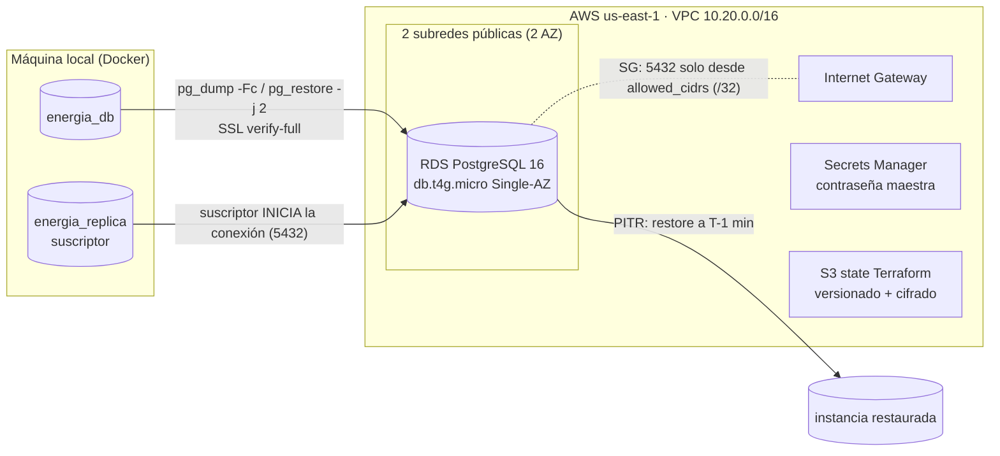

# Entrega 2: RDS PostgreSQL, replicación lógica y PITR

Proyecto energía-db · Región us-east-1 · Tags `Proyecto=energia-db`, `Entrega=E2`.
Los bloques `PEGAR` se llenan con los logs de `evidencias/E2/` después de ejecutar cada paso.

## 1. Arquitectura



## 2. Decisiones

| Decisión | Por qué | Costo de la decisión |
|---|---|---|
| RDS en subred pública + SG por IP /32 (en vez de subred privada + bastion) | Entrega individual de pocos días: sin bastion ni NAT (una EC2 + NAT Gateway costaría más que la propia RDS). El SG solo admite IPs /32 y la variable rechaza `0.0.0.0/0`. | Superficie expuesta a Internet; mitigada con SG, `rds.force_ssl=1` y `verify-full`. En producción: subred privada + bastion/SSM o VPN. |
| La réplica local se **suscribe** a RDS | En replicación lógica el suscriptor abre la conexión: RDS no necesita alcanzar la máquina local (detrás de NAT/WSL). | Slot en RDS retiene WAL si el suscriptor cae: `apagar_replica.sh` lo borra. |
| `manage_master_user_password=true` | La contraseña vive en Secrets Manager y no pasa por state, repo ni outputs; los scripts la leen y no la imprimen. | Secreto ≈ USD 0,40/mes. |
| State en S3 con `use_lockfile` | Sin DynamoDB; versionado permite recuperar un state previo. | Bucket creado aparte con la CLI, fuera de Terraform. |
| `engine_version` 16.13 | Misma versión mayor que `POSTGRES_VERSION=16`; verificada con `aws rds describe-db-engine-versions`. `auto_minor_version_upgrade=false` evita deriva. | Parches menores manuales. |
| Backup 07:00–08:00 UTC | = 02:00–03:00 en Colombia (UTC-5), fuera de horario. Retención de 1 día habilita PITR. | **Desviación del pedido (7 días):** `FreeTierRestrictionError` en la cuenta de plan gratuito; la ventana de recuperación es de 24 h. |
| Publicación `FOR TABLES IN SCHEMA energia` + `control.replica_demo` | Toda tabla publicada tiene PK (verificado por `replica.sh`); sin tablas particionadas, `publish_via_partition_root` queda en `false` (el script lo activa si aparecen). | |

### Costos (estimación, precios de lista us-east-1; verificar en la calculadora de AWS)

| Concepto | USD/mes aprox. |
|---|---|
| db.t4g.micro Single-AZ (~730 h) | 11,7 |
| 20 GB gp3 | 2,3 |
| IPv4 pública de la instancia | 3,7 |
| Secrets Manager | 0,4 |
| Backups (hasta el tamaño de la base) / Performance Insights 7 d | 0 |
| **Total** | **≈ 18** |

Un presupuesto de USD 10 se superaría en ~17 días de uso continuo (el presupuesto se configuró en la cuenta, fuera de Terraform). Por eso conviene `make destruir` apenas se tengan las evidencias. La instancia restaurada de PITR suma ~USD 0,03/h mientras exista.

## 3. Comandos ejecutados

```bash
# bucket del state: creado aparte con aws s3api (tfstate-proyecto-admindb-<account_id>, versionado, cifrado, sin acceso público)
cp infra/terraform/terraform.tfvars.example infra/terraform/terraform.tfvars   # editar: allowed_cidrs (bash infra/aws/mi_ip.sh)

make tf-init && make tf-plan && make tf-apply   # muestra el plan y espera "yes"
make migrar         # pg_dump -Fc -> pg_restore --no-owner --no-privileges -j 2 -> ANALYZE
make paridad        # local vs RDS + bateria E1
make replica        # replicador, publicacion, energia_replica y suscripcion
make demo-replica   # INSERT/UPDATE/DELETE con latencia
make pitr           # marcador, DELETE de un mes, restore a T-1 min, verificacion
make destruir       # instancias restauradas + terraform destroy
```

Orden importa: `paridad` antes de `replica` (agrega `control.replica_demo`) y antes de `pitr` (borra un mes en RDS).

## 4. Resultados

### 4.1 Infraestructura
PEGAR: resumen de `evidencias/E2/tf-plan_*.log` (recursos a crear) y de `tf-apply_*.log` (`Apply complete`, outputs).

### 4.2 Migración y paridad
PEGAR: tamaño del dump, código de salida de `pg_restore` y tabla de paridad de `evidencias/E2/migrar_*.log` y `paridad_*.log` (filas, sumas, min/max, md5; PASS de 051 y 052 en local y en RDS).

### 4.3 Replicación lógica
PEGAR: latencias de INSERT/UPDATE/DELETE, `pg_stat_subscription` y `pg_replication_slots` de `demo-replica_*.log`. La latencia incluye ~100 ms del sondeo con `docker exec`.

### 4.4 PITR
PEGAR: hora del marcador y del DELETE y conteos antes/después de `evidencias/E2/pitr_*.log` (corrida fallida).

**Limitación:** la restauración (`restore-db-instance-to-point-in-time`) falló con `InstanceQuotaExceeded`: el plan gratuito de AWS no permite una segunda instancia, y PITR siempre crea una nueva. Se decidió no subir de plan. Quedan demostrados el marcador, el `latest-restorable-time` que avanza cada ~5 min (retención de 1 día) y el DELETE de 18762 filas de `2026-09-01`; **no** quedó demostrada la restauración ni la verificación en la instancia restaurada. El mes se repuso en RDS desde la base local con `infra/aws/reponer_mes.sh` (PEGAR resultado de `reponer_mes`).

## 5. Capturas de consola (AWS)

1. S3: bucket del state (versionado, cifrado, bloqueo de acceso público).
2. VPC: subredes, route table con IGW, security group (regla 5432 con la /32).
3. RDS: resumen de la instancia (clase, Single-AZ, 20 GB gp3, cifrado, public access).
4. RDS: parameter group con `rds.logical_replication=1`, `rds.force_ssl=1`, `log_min_duration_statement=500`.
5. RDS: Backup y ventana de mantenimiento; "Latest restore time".
6. Secrets Manager: secreto de la contraseña maestra (sin revelar el valor).
7. Performance Insights con retención de 7 días.
8. AWS Budgets: presupuesto de la cuenta con sus alertas.
9. RDS: instancia restaurada por PITR (antes de borrarla).
10. Cost Explorer / Billing tras la prueba.
